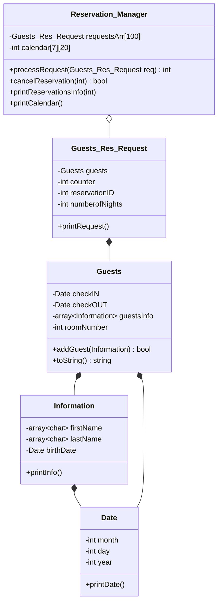

# Hotel Reservation System

[](https://github.com/Radmehr0/Hotel_reservation/actions/workflows/build.yml)


A console-based hotel room reservation system written in C++. It books rooms for groups of guests,
rejects double bookings, supports cancellations, and prints a room-by-night occupancy calendar.

This was my first C++ project. It was built to practise object-oriented design: classes, composition,
copy constructors, static members, and manual memory management.

## Features

- **Book a room** for 1–4 guests, each with a name and date of birth
- **Conflict detection**: a booking is refused if any night overlaps an existing reservation for that room
- **Input validation** for room numbers, date ranges and guest counts
- **Cancel a reservation** by ID, which frees its nights on the calendar
- **Look up a reservation** by ID and print the full guest details
- **Occupancy calendar** showing which reservation ID holds each room on each night
- **Interactive mode** so you can make your own booking from the keyboard

## Demo

The program first runs five scripted scenarios (successful booking, conflicting booking, a second room,
a 5th guest being refused, a cancellation) and then asks you for your own reservation:

```text
Enter your room number (1-20):
12
Enter check-in day in March:
2
Enter check-out day in March:
5
...
Reservation ID: 5 CONFIRMED!

========== Calendar after User reservation ==========

Night\Room     1   2   3   4   5   6   7   8   9  10  11  12  13  14  15  16  17  18  19  20
--------------------------------------------------------------------------------------------
Mar 1          4   0   0   0   0   0   1   0   0   0   0   0   0   0   0   0   0   0   0   0
Mar 2          0   0   0   0   0   0   1   0   0   0   0   5   0   0   0   0   0   0   0   0
Mar 3          0   0   0   0   0   0   1   0   0   0   0   5   0   0   0   0   0   0   0   0
Mar 4          0   0   0   0   0   0   0   0   0   0   0   5   0   0   0   0   0   0   0   0
Mar 5          0   0   0   0   0   0   0   0   0   0   0   0   0   0   0   0   0   0   0   0
Mar 6          0   0   0   0   0   0   0   0   0   0   0   0   0   0   0   0   0   0   0   0
Mar 7          0   0   0   0   0   0   0   0   0   0   0   0   0   0   0   0   0   0   0   0

Reservation successful! ID = 5
Reservation details:
Reservation Info:
ReservationID: 5
Number of Nights: 3
Room Number: 12
Check-IN: 2026/3/2
Check-OUT: 2026/3/5
Guest Count: 1
Guest 1: Alex Rivera (Date of birth: 1999/4/9)
```

Each cell is the reservation ID occupying that room on that night (`0` = free).

## Design



| Class | Responsibility |
|---|---|
| `Date` | A calendar date (month, day, year) |
| `Information` | One guest: first name, last name, date of birth |
| `Guests` | One stay: room number, check-in/check-out dates and up to 4 guests |
| `Guests_Res_Request` | Wraps a stay with an auto-incrementing reservation ID and the number of nights |
| `Reservation_Manager` | Owns all reservations and the `nights × rooms` occupancy calendar; books, cancels and prints |

## Project structure

```text
Hotel_reservation/
├── include/            # Class declarations (.h)
├── src/                # Class implementations (.cpp) and main.cpp
├── .github/workflows/  # GitHub Actions: builds on Linux, Windows and macOS
├── CMakeLists.txt
├── LICENSE
└── README.md
```

## Building and running

**Requirements:** a C++17 compiler (GCC, Clang or MSVC) and CMake 3.16+.

### With CMake (recommended)

```bash
git clone https://github.com/Radmehr0/Hotel_reservation.git
cd Hotel_reservation
cmake -S . -B build
cmake --build build
./build/hotel_reservation        # Windows/MSVC: .\build\Debug\hotel_reservation.exe
```

### With g++ directly

```bash
g++ -std=c++17 -Wall -Wextra -I include src/*.cpp -o hotel_reservation
./hotel_reservation
```

On Windows, both commands work in an MSYS2 UCRT64 terminal.

## Current limitations

- The booking window is fixed to **March 1–7, 2026**, with 20 rooms and up to 4 guests per room.
- The number of nights is calculated from the day of the month only, so stays can't cross into another month.
- Reservations live in memory only and are lost when the program exits.

## Roadmap

- [ ] Menu-driven interface (book / cancel / look up / calendar / quit)
- [ ] Save and load reservations from a file
- [ ] Configurable date range and proper date arithmetic
- [ ] Room types and pricing
- [ ] Unit tests

## License

This project is licensed under the [MIT License](LICENSE).

## Author

**Radmehr Mahmoudi** · [GitHub @Radmehr0](https://github.com/Radmehr0)
